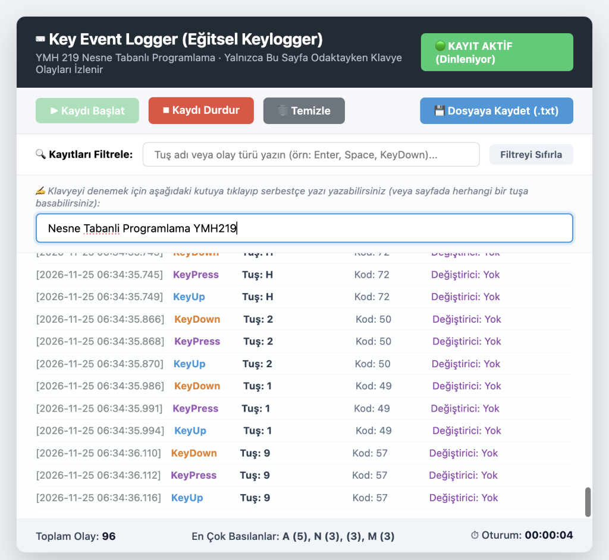
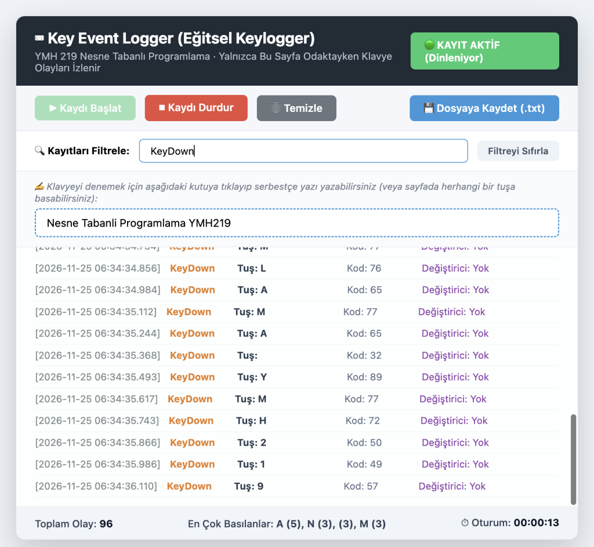

# ⌨ Key Event Logger (Eğitsel Keylogger) - YMH219

**Nesne Tabanlı Programlama (YMH 219)** dersi kapsamında geliştirilen, form içi klavye olaylarını yakalayan, analiz eden ve yerel dosyaya kaydedebilen Windows Forms masaüstü uygulaması.

🎮 **Canlı Web Demosu (Tarayıcıda Hemen Deneyin):** [https://meryemmelek41-mm.github.io/YMH219-KeyEventLogger/](https://meryemmelek41-mm.github.io/YMH219-KeyEventLogger/)

---

## 📋 Proje Hakkında

Bu uygulama, C# ve .NET ortamında klavye olaylarının (`KeyDown`, `KeyUp`, `KeyPress`) nasıl yakalandığını, olay verilerinin nesne tabanlı mimari ile nasıl modellendiğini, istatistiklerinin nasıl çıkarıldığını ve dosya akışları (`StreamWriter`) ile yerel metin dosyalarına nasıl aktarıldığını göstermek amacıyla geliştirilmiştir.

> 🔒 **Kapsam ve Güvenlik Beyanı:**  
> Bu uygulama **kesinlikle kötü amaçlı bir sistem keylogger'ı değildir**. Yalnızca kendi penceresi odaktayken klavye olaylarını dinler (`KeyPreview = true`). Global keyboard hook, arka plan/gizli çalışma, başlangıçta otomatik çalışma veya ağ üzerinden veri aktarımı içermez. Tüm güvenlik sınırlarına eksiksiz uymaktadır.

---

## 🛠️ Kullanılan Teknolojiler

- **C# / .NET 6.0 (Windows Forms)** - Temel programlama dili ve masaüstü çatı
- **Visual Studio 2022** - Geliştirme ortamı
- **System.IO (StreamWriter)** - Dosya dışa aktarma işlemleri
- **LINQ** - Olay filtreleme ve en çok basılan tuş istatistikleri
- **HTML5 / CSS3 / JavaScript** - Web önizleme ve canlı demo arayüzü

---

## 🚀 Kurulum ve Çalıştırma

### 1. Windows Forms (C# / .NET) - Ana Masaüstü Uygulaması
1. Projeyi bilgisayarınıza klonlayın:
   ```bash
   git clone https://github.com/meryemmelek41-mm/YMH219-KeyEventLogger.git
   ```
2. `KeyEventLogger.sln` dosyasını **Visual Studio 2022** ile açın.
3. Çözümü derleyin ve **F5** tuşuna basarak (veya *Start Debugging*) çalıştırın.

**Gereksinimler:**
- Windows 10/11
- Visual Studio 2022 veya üzeri
- .NET 6.0 SDK (Windows Desktop desteği ile)

### 2. Web Önizleme (Tarayıcı Üzerinden Anında Kullanım)
Windows ortamı olmayan veya uygulamayı anında tarayıcısında denemek isteyenler için:
- [Canlı Web Demosu](https://meryemmelek41-mm.github.io/YMH219-KeyEventLogger/) linkine tıklayabilir veya projedeki `preview/index.html` dosyasını tarayıcınızda çift tıklayarak açabilirsiniz.

---

## 🎮 Uygulamanın Temel Özellikleri

- **Olay Yakalama:** Form aktifken basılan tuşların adı (`KeyName`), sayısal kodu (`KeyCode`), değiştirici tuşlar (`Shift, Ctrl, Alt`) ve milisaniye hassasiyetli zaman damgası listelenir.
- **Kayıt Kontrolü:** "▶ Kaydı Başlat" ve "⏹ Kaydı Durdur" butonları ile dinleme durumu kontrol edilir.
- **Açık Durum Göstergesi:** Üst panelde durum anlık olarak renkli ve metinli bildirimle gösterilir (🟢 `KAYIT AKTİF` / 🔴 `KAYIT DURDURULDU`).
- **Ekranı Temizleme:** "🗑 Temizle" butonu ile ekrandaki loglar onay alınarak sıfırlanabilir.
- **Dosyaya Kaydetme (.txt):** "💾 Dosyaya Kaydet (.txt)" butonu ile tüm kayıtlar, oturum özeti ve tuş istatistikleriyle birlikte `.txt` dosyasına yazılır (`StreamWriter` ile hata kontrolü yapılarak).
- **Test Yazma Alanı:** Kullanıcının tuşları rahatça deneyebileceği özel metin giriş kutusu bulunur.

### 🌟 İsteğe Bağlı Geliştirmeler (Bonus Özellikler)
- **İstatistik Paneli:**
  - Toplam yakalanan olay sayısı canlı olarak sayılır.
  - En çok basılan ilk tuşlar ve basılma adetleri (örn: `A (5), Space (3)`) LINQ ile hesaplanarak alt panelde gösterilir.
  - Oturum süresi canlı sayaç (`⏱ Oturum: HH:mm:ss`) ile takip edilir.
- **Kayıt Filtreleme:** Arama kutusu (`txtFilter`) üzerinden tuş adına veya olay türüne göre anlık filtreleme yapılabilir ("Filtreyi Sıfırla" butonu mevcuttur).

---

## 🏗️ Proje Yapısı

```
YMH219-KeyEventLogger/
├── KeyEventLogger.sln              # Visual Studio Çözüm Dosyası
├── .gitignore                      # Derleme ve geçici dosyaları dışlama kuralları
├── README.md                       # Proje dokümantasyonu
├── docs/                           # GitHub Pages canlı web demo dosyaları
│   └── index.html
├── preview/                        # Yerel web önizleme dosyası
│   └── index.html
└── KeyEventLogger/
    ├── KeyEventLogger.csproj       # .NET 6.0 WinForms proje dosyası
    ├── Program.cs                  # Uygulama giriş noktası
    ├── FormMain.cs                 # Ana form - arayüz ve olay yönetimi
    ├── FormMain.Designer.cs        # Form bileşenleri tasarım kodu
    ├── KeyEventModel.cs            # Tuş olayı veri modeli (OOP)
    ├── KeyLoggerService.cs         # Kayıt, filtreleme, istatistik ve dosya servisi (OOP)
    └── screenshots/
        ├── active_logging.png      # Aktif kayıt ve tuş listesi ekran görüntüsü
        └── filtered_stats.png      # Filtreleme ve istatistik ekran görüntüsü
```

---

## 📸 Ekran Görüntüleri

### 1. Aktif Tuş Kaydı ve İstatistikler


### 2. Filtrelenmiş Liste ve Detaylı Görünüm


---

## ⚙️ Nesne Tabanlı Tasarım (OOP)

| Sınıf / Bileşen | Sorumluluk |
|---|---|
| `KeyEventModel` | Her bir klavye olayının zaman damgasını, tuş adını, kodunu, değiştirici durumunu ve biçimlendirilmiş metin çıktılarını kapsüller. |
| `KeyLoggerService` | Kayıt durumunu (`IsLoggingActive`), olay koleksiyonunu, LINQ istatistik hesaplamalarını (`GetTopKeys`), arama/filtreleme algoritmalarını ve güvenli dosya yazma (`SaveToFile`) işlemlerini yönetir. |
| `FormMain` | Kullanıcı arayüzünü (butonlar, filtre kutusu, durum rozeti, ListBox) yönetir, form klavye olaylarını yakalar ve servise iletir. |

---

## ⚠️ Bilinen Sınırlamalar

- Uygulama masaüstü ortamında Windows Forms altyapısı kullandığından yerel exe sürümü Windows işletim sisteminde çalışır.
- Yalnızca uygulama penceresi odaktayken tuşları dinler (eğitsel güvenlik kuralı gereği arka planda çalışmaz).

---

## 👤 Öğrenci Bilgileri

- **Adı Soyadı:** Meryem Melek Şimşek  
- **Öğrenci No:** 250541017  
- **Ders:** Nesne Tabanlı Programlama (YMH 219)  
- **Ödev No:** 2 (Key Event Logger)
